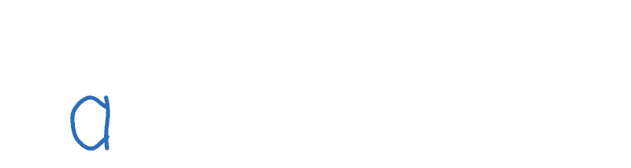
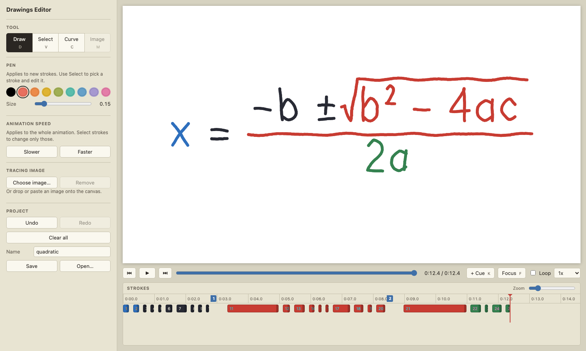

# quarto-revealjs-drawings

A Quarto extension that plays saved drawings inside revealjs slides as solid colored lines, one fragment per click.



## Install

```bash
quarto add EmilHvitfeldt/quarto-revealjs-drawings
```

Or copy `_extensions/drawings/` into your deck's folder.

## Use

Turn the plugin on and put the shortcode on a slide:

```markdown
---
format: revealjs
revealjs-plugins:
  - drawings
---

## My slide


```

A drawing is a `.json` file made with the [editor](#making-drawings). It can have stopping points called cues: each click plays the drawing up to the next cue, and going back undraws it. Without cues the drawing plays in one click.

Options, all optional:

- `auto="true"`: play the first segment as soon as the slide appears (so it needs one click less)
- `speed="1.5"`: playback speed
- `width="60%"`: any CSS width; the drawing keeps its 16:9 shape

A deck with `embed-resources: true` stays a single file. Printing to PDF (`?print-pdf`) shows every drawing finished. The background is transparent, so the slide's own background shows through.

Don't keep your drawings in a folder called `drawings` next to the deck: Quarto would mistake it for the plugin directory.

## Making drawings

`_extensions/drawings/editor/index.html` is a small editor for recording drawings. It installs with the extension: open the file in a browser, no server needed. What you see in the editor is what the slide shows.



- **Draw** (D): draw on the canvas. Every stroke is recorded with its position, pressure and timing, and the timeline plays while you draw.
- **Select** (V): click a stroke to change its color, size, start time or speed, drag it to move it, or delete or duplicate it. You can also click its clip in the timeline.
- **Curve** (C): reshape a stroke's path by dragging its anchors and handles.
- **Timeline**: drag a clip to retime a stroke, drag its right edge to stretch it, click the ruler to scrub.
- **Transport**: play/pause (Space), jump to start/end (Home/End), step a frame (arrows, Shift for one second), loop, 0.25x to 2x.
- **Cues**: press `+ Cue` (K) to drop a stopping point at the playhead. The extension pauses there and plays the next segment on the next click.
- **Tracing image**: choose, drop or paste an image to draw over. It is a view aid only and isn't saved.
- **Project**: undo/redo, and save or open a `.json` file. Save the file next to your deck and point `` at it.

## Drawing format

```json
{
  "version": 1,
  "cues": [{ "ms": 2000 }],
  "strokes": [
    {
      "start": 0,
      "speed": 1,
      "size": 0.2,
      "color": { "r": 83, "g": 105, "b": 7 },
      "points": [{ "x": 0.1, "y": 0.08, "pressure": 0.58, "t": 0 }]
    }
  ]
}
```

`x` and `y` are fractions of the drawing (0 to 1), `t` is milliseconds since the stroke began, and `start` is when it begins on the timeline. Colors are drawn fully opaque, and line width follows `size` and `pressure`. Extra fields from other tools are ignored.

## Example

`example/slides.qmd` is a small deck of four handwritten math equations, one per slide:

- `pythagoras`: no cues, plays through on its own (`auto=true`)
- `quadratic`: two cues, so three segments. The first plays by itself, then one click each for the square root and the denominator
- `euler`: two cues and no `auto`, so the slide starts blank and every click writes the next piece
- `sum`: two cues and a faster pen (`speed=1.5`)

Render it with `quarto render example/slides.qmd`.

For slides that keep a fixed size so a drawing always fits the frame, the [letterbox](https://github.com/EmilHvitfeldt/quarto-revealjs-letterbox) format works well with this extension.
